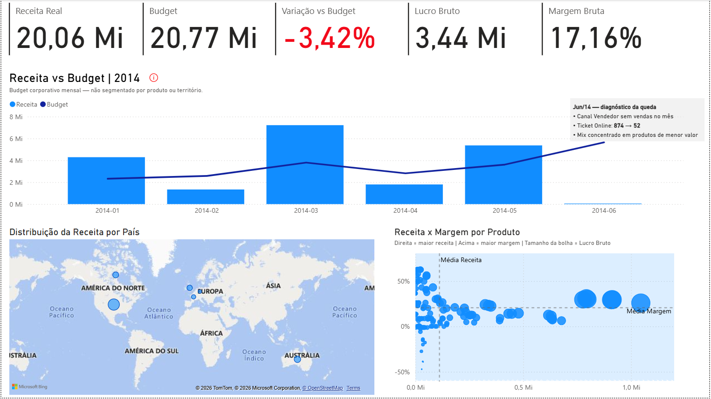

# AdventureWorks Financial Performance

## Objetivo

Documentar um projeto de análise de desempenho financeiro com dados AdventureWorks, incluindo o acompanhamento de resultados, a comparação com o Budget e a investigação da anomalia de junho de 2014.

O repositório está em preparação. O PBIX e os arquivos auxiliares já foram adicionados. A documentação utiliza os prints fornecidos do dashboard, do modelo e do Power Query; medidas e conclusões ainda precisam de validação.

## Ferramentas utilizadas

- Power BI: modelo de dados, medidas DAX e dashboard.
- Power Query (linguagem M): conexão com fontes e construção do calendário.
- SQL Server / T-SQL: consultas ao banco `AdventureWorks2016`.
- Excel: fonte importada para a tabela de Budget.

## Arquitetura / fluxo de dados

Fluxo observado nos prints do Power Query:

```text
SQL Server / AdventureWorks2016 → SQL via Power Query → FactSales, DimProduct, DimTerritory
FactSales[DataOrdem] → Calendário em M → DimCalendar
Excel / Tabela1 → Power Query → FactBudget
Tabelas → Relacionamentos e medidas DAX → Dashboard no Power BI
```

As três consultas SQL transcritas estão em `sql/01_fact_sales.sql`, `sql/02_dim_product.sql` e `sql/03_dim_territory.sql`. Não foram executadas contra o banco nesta etapa.

O calendário começa na menor `FactSales[DataOrdem]` e termina no último dia do mês da maior data de ordem. O código M gera uma sequência diária e adiciona ano, mês, nome do mês, ano-mês (`yyyy-MM`) e trimestre; a coluna `Data` recebe o tipo `datetime` no código mostrado.

A FactBudget importa a tabela estruturada `Tabela1` de `budget/Receita_2013_Jan_Jun.xlsx`. O código M fornecido apenas importa os dados e define tipos: `Ano` e `Mes` como inteiros; `Receita`, `MetaCrescReal`, `IPCA_Premissa`, `CrescNominal` e `Budget14` como números; `DataBudget` como data/hora. Não há cálculo do orçamento nessa consulta: `Budget14` já vem do Excel. As fórmulas e premissas de construção no Excel ainda precisam ser confirmadas. O código está registrado em [documentation/insights.md](documentation/insights.md#código-m-da-factbudget).

Para atualizar o relatório em outro computador, será necessário configurar a conexão com o SQL Server e ajustar o caminho local do Excel. Os prints mostram uma conexão e um caminho específicos da máquina de desenvolvimento; o procedimento completo ainda precisa ser validado.

### Premissas do Budget de 2014

A base fornecida utiliza as receitas de janeiro a junho de 2013 para projetar os mesmos meses de 2014, com meta de crescimento real de 5% e IPCA acumulado de 2013 de 5,91%, confirmado na [publicação do IBGE](https://agenciadenoticias.ibge.gov.br/agencia-sala-de-imprensa/2013-agencia-de-noticias/releases/14551-asi-ipca-de-dezembro-fica-em-092-e-fecha-2013-em-591).

Os valores são consistentes com a composição multiplicativa das premissas:

```text
Crescimento nominal = (1 + 5%) × (1 + 5,91%) − 1 = 11,2055%
Budget mensal 2014 = Receita do mesmo mês de 2013 × 1,112055
```

A coluna CrescNominal exibe 11,21% por arredondamento. O recálculo com a receita original do CSV reproduz os seis valores de Budget informados, quando arredondados a centavos. O total calculado antes do arredondamento é 20.768.541,66, compatível com os 20,77 Mi do dashboard. A fórmula acima foi inferida e conferida numericamente; as fórmulas das células do Excel ainda não foram inspecionadas.

O IPCA é usado como premissa deste exercício de portfólio, e não como inflação realizada de 2014. A base cobre seis meses e não representa um orçamento anual completo. O detalhamento está em [documentation/insights.md](documentation/insights.md#construção-do-budget-de-2014).

## Principais KPIs

Valores exibidos no print com filtro de página em 2014 e eixo mensal de janeiro a junho:

| KPI | Valor exibido |
|---|---:|
| Receita Real | 20,06 Mi |
| Budget | 20,77 Mi |
| Variação vs Budget | −3,42% |
| Lucro Bruto | 3,44 Mi |
| Margem Bruta | 17,16% |

Valores arredondados conforme o visual. A moeda e o período efetivo dos cartões ainda precisam ser confirmados. As fórmulas DAX fornecidas estão registradas em [documentation/insights.md](documentation/insights.md#medidas-dax-fornecidas), com as seguintes definições:

| Medida | Regra de cálculo |
|---|---|
| Receita | Soma de `FactSales[ReceitaLqd]`, originada de `SalesOrderDetail.LineTotal`. |
| Budget | Soma de `FactBudget[Budget14]`. |
| CustoTotal | Soma, por item de venda, da quantidade multiplicada pelo custo padrão do produto relacionado. |
| LBruto | Receita menos CustoTotal. |
| MargemBruta% | LBruto dividido pela Receita. |
| VarBudget | Receita menos Budget. |
| VarBudget% | VarBudget dividido pelo Budget. |
| AtingimentoBudget% | Receita dividida pelo Budget. |
| QtdVenda | Soma das quantidades vendidas. |
| QtdOrdemVenda | Contagem distinta dos pedidos de venda. |
| TktMedio | Receita dividida pela contagem distinta de pedidos. |
| ReceitaMedProd | Média aritmética da medida Receita entre os produtos no contexto. |
| MargemMedProd | Média aritmética da medida MargemBruta% entre os produtos no contexto. |

As medidas respeitam o contexto de filtro do modelo. As médias por produto usam `AVERAGEX` e não ponderam por receita ou quantidade; resultados em branco não entram na média. A Margem Bruta total é a razão entre lucro e receita totais, e não a média das margens dos produtos.

O custo usa `DimProduct[CustoPadrao]`, sem busca de custo histórico por data na fórmula fornecida. As divisões usam `/`, sem tratamento explícito de denominador zero ou em branco. A medida de formatação `CorVarBudgetTooltip` foi vista na lista, mas sua fórmula não foi fornecida. As fórmulas foram documentadas, sem alteração no PBIX ou execução no modelo.

## Dashboard



[Acessar dashboard interativo no Power BI]([https://app.powerbi.com/groups/me/reports/e83e6cd0-3a27-49fc-a29d-ac95a1acadd6?ctid=06973f68-bd6d-4da4-a19d-ad9118b7c409&pbi_source=linkShare])

O dashboard apresenta comparação mensal de receita com Budget, distribuição da receita por país e dispersão de receita versus margem por produto. Na dispersão, o tamanho das bolhas representa lucro bruto e as linhas de referência indicam médias de receita e margem.

## Principais insights

A receita aparece 3,42% abaixo do Budget no recorte exibido. O dashboard identifica o Budget como corporativo mensal, sem segmentação por produto ou território. A interpretação e as limitações estão registradas em [documentation/insights.md](documentation/insights.md).

## Investigação da anomalia de junho/2014

O gráfico mostra forte queda da receita em junho. A anotação do dashboard informa ausência de vendas no canal Vendedor, ticket Online passando de 874 para 52 e mix concentrado em produtos de menor valor. Esses pontos são o diagnóstico exibido, ainda sem validação independente pelas consultas e medidas. O período de comparação do ticket e a completude de junho precisam ser confirmados.

Consulta reservada em [sql/05_analise_junho_2014.sql](sql/05_analise_junho_2014.sql).

## Modelagem de dados

| Tabela | Função e evidência disponível |
|---|---|
| FactSales | Vendas no nível de item do pedido, conforme a junção de SalesOrderDetail com SalesOrderHeader. |
| DimProduct | Produtos, incluindo código, nome, custo padrão, preço de lista e identificador de subcategoria. |
| DimTerritory | Territórios, código de país e grupo territorial. |
| DimCalendar | Calendário diário gerado em M a partir das datas de ordem. |
| FactBudget | Budget importado do Excel; granularidade mensal indicada no dashboard, a validar na base. |
| 00_fx | Organização das medidas DAX, sem relacionamentos visíveis. |

No diagrama, DimProduct e DimTerritory se relacionam com FactSales. DimCalendar se relaciona com FactSales e FactBudget. As relações aparecem ativas, de um para muitos e com filtro da dimensão para a fato. As colunas exatas usadas nos relacionamentos ainda precisam de confirmação.

Não há relações visíveis de produto ou território com FactBudget, coerentemente com o Budget corporativo informado no dashboard.

Na consulta de vendas, valores de cabeçalho como `SubTotal`, `Impostos`, `Frete` e `TotalPedido` se repetem para cada item do mesmo pedido. As medidas fornecidas não somam esses campos: Receita usa o valor da linha (`ReceitaLqd`) e QtdOrdemVenda usa contagem distinta. Futuras medidas que somem valores de cabeçalho deverão evitar dupla contagem.

## Estrutura do repositório

```text
AdventureWorks-Financial-Performance/
├── README.md
├── dashboard/
├── images/
├── sql/
│   ├── 01_fact_sales.sql
│   ├── 02_dim_product.sql
│   ├── 03_dim_territory.sql
│   ├── 04_budget_base.sql
│   └── 05_analise_junho_2014.sql
├── budget/
└── documentation/
    └── insights.md
```

`dashboard/` contém o PBIX. `budget/` contém o Excel, o CSV e o TXT de receita de janeiro a junho de 2013. O TXT contém uma consulta SQL e ainda precisa ter sua organização revisada. `images/` aguarda a imagem final; pastas vazias não são versionadas pelo Git. A árvore acima apresenta a organização das pastas e os arquivos de documentação previstos, sem listar todos os materiais auxiliares.
